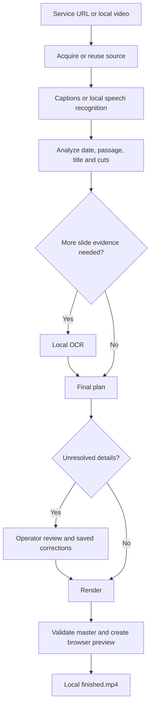

# Architecture and data flow

[Home](../README.md) · [Development](DEVELOPMENT.md)

## Processing stages

`ccs/cli.py` coordinates the pipeline. `acquire.py` handles yt-dlp, source paths and job IDs. `transcribe.py` selects usable English captions or CPU faster-whisper, with channel analysis before mono conversion, and checks bounded audio excerpts when caption evidence is deficient. `ocr.py` reads relevant slide evidence. `analyze.py` combines transcript/slide evidence and Bible matching. `audio.py` prepares and caches phase-safe enhanced audio; `audio_setup.py` verifies its independently downloaded native tool. `render.py` builds the card, cuts/stabilizes media, writes chapters and validates outputs. `web.py` serves the interface in `index.html`; `common.py` supplies paths, JSON/status writing, commands and the shared processing lock.

## AI and deterministic work

The speech/OCR models run locally. Passage matching against the World English Bible and evidence rules are code, not a cloud language model. Current Linux speech enhancement uses the verified native DeepFilterNet3 tool with a 20 dB suppression cap, followed by gentle FFmpeg filtering and a soft expander limited to 6 dB attenuation. FFmpeg-only cleanup is used when the tool is absent; the selected method is explicit in the job settings. One playback gain targets -20 LUFS, with an 18 dB gain cap and a -2 dBFS lookahead peak limiter whose automatic makeup is disabled. Dynamic upward normalization, presence boost and general compression are omitted. AAC encoding can alter peaks, so final validation measures integrated loudness/true peak and rejects a peak above -0.5 dBTP. Stabilization uses a modest 3% zoom. See [audio evidence and limitations](AUDIO_RESEARCH.md); speech-like audience sound and room reflections can remain.

The master copies the joined video and encodes enhanced PCM audio once, after adding exactly five seconds of initial silence. S32 conversion before AAC resolved a complete-file near-silence encoder stall observed during validation; the precise internal codec cause is unproven. Avoid restoring the former AAC decode/re-encode concatenation, which also added about 21 ms of audio delay. The regression test checks master alignment against normalized PCM.

The special opposed-stereo source makes the phase check essential. Do not simplify audio handling to unconditional stereo averaging. Tests exercise the cancellation case and a full synthetic render.

## Evidence and reusable work

| Files in a job | Purpose |
|---|---|
| `source.mp4`, `source.info.json`, `input.json` | Download, source metadata and input |
| `source-path.json` | Reference to an externally supplied local source |
| `transcript.json`, `transcript.txt`, `screen-text.json` | Cached recognition/caption/OCR evidence |
| `transcript-refined.json`, `transcript-refined.txt`, `speech-check-*.wav` | Separate bounded local verification and source/model provenance; original transcript preserved |
| `cleaned-audio.wav`, `audio-settings.json`, `loudness.json` | Enhanced mono PCM, cache identity and constant playback gain measurements |
| `plan.json`, `review.json` | Current analysis plan and operator corrections |
| `status.json`, stage `.log` files | Progress, timing and diagnostics |
| `sermon.mp4`, `media-settings.json`, `transforms.trf`, `measurement-settings.json` | Processed sermon, rendering cache settings and stabilization/audio evidence |
| `intro.png`, `intro.mp4` | Generated introduction |
| `sermon-details.json`, `chapters.ffmeta` | Result metadata and chapter construction |
| `finished.mp4`, `validation.json` | Full-quality master and validation |
| `preview.mp4`, `preview-settings.json`, `preview-validation.json` | Browser-compatible derivative and its checks |

Not every source/stage creates every file. Completed transcription and OCR are reused; a failed partial stage is retried. Refined transcripts use a fingerprint of original evidence, source identity, windows and inference settings. Rendering caches include the audio profile and enhancer hash; intro edits reuse the sermon, and audio-only changes preserve the already stabilized video when all video/cut settings match. Extra input context and compensated filter latency preserve audio sync and final syllables. JSON writes use temporary files and replacement. The cross-process file lock and web worker logic prevent concurrent production processing. A browser close does not kill the background server. Linux uses `flock`; Windows uses an `msvcrt` byte-range lock with a shared per-user file, including CLI and desktop operations.

## Installation boundaries

Version 1.1 installs app files under `/usr/lib/ccs-video-cleanup` and a launcher under `/usr/bin`. APT owns standard libraries and FFmpeg. `packaging/setup_user.py` creates the user's venv with system-site-packages, constrains APT libraries, installs the specialist packages, verifies filters/imports/OCR/model access and writes a successful marker only at the end. Setup is serialized. The launcher uses cached models offline after setup.

RapidOCR 1.4.4 has historical Python `<3.13` metadata. The one pure-Python wrapper is installed with that metadata restriction overridden on Debian 13, without its separate OpenCV wheel; actual OCR was tested on both target Python versions. Native-package interpreter restrictions are not bypassed. See [dependency details](../packaging/THIRD_PARTY.md).

## Configuration

These variables are read when Python modules import. Use isolated data paths when developing:

| Variable | Original source default | Role |
|---|---|---|
| `CCS_DATA_DIR` | Repository root | Contains jobs and `.tools/pipeline.lock` |
| `CCS_BIN_DIR` | Repository `.tools/bin` | FFmpeg/ffprobe command directory and PATH prefix |
| `CCS_MODEL_DIR` | Repository `.models/whisper` | Whisper model cache |
| `CCS_YTDLP` | Repository `.venv/bin/yt-dlp` | Downloader executable |
| `CCS_LOGO` | Repository `assets/church-logo.png` | Optional intro image; text fallback when absent |
| `CCS_SPEECH_ENHANCER` | Verified tool at `CCS_DATA_DIR/.tools/bin/deep-filter`, if installed | Explicit path permits a custom compatible tool; its hash is recorded |
| `OMP_NUM_THREADS` | `6`, if unset | CPU worker setting |

The packaged launcher sets its own appropriate paths into user data and `/usr/bin`; inspect `packaging/launch` before assuming an external override will survive it. `XDG_DATA_HOME` changes the package's user-data base. The public-domain Bible remains an application asset.

## Network and privacy boundary

The web server binds to loopback and has no account/password authentication. Treat it as a local desktop application, not a remotely hosted service. It validates media paths and requires its expected JSON request header for POST operations; these are not a replacement for authentication if someone changes the bind/proxy configuration.

Dependency/model downloads and YouTube acquisition need internet access. YouTube sign-in cookies are read locally when requested. Transcripts, OCR, manual review and media remain in local jobs. Nothing is automatically uploaded. Keep jobs, caches, cookies and credentials out of commits and issue attachments.

## Windows desktop lifecycle

`packaging/windows/launcher.py` uses an isolated embedded Python runtime and private library directory. Data defaults to `%LOCALAPPDATA%\CCSVideoCleanup`; the application defaults to `%LOCALAPPDATA%\Programs\CCSVideoCleanup`. A first-run loopback page prepares tools, checks their hashes/native imports and warms the model before switching to the normal interface. A successful dependency checkpoint avoids repeating wheel installation after a later download failure. Only a completed setup writes `setup.json`.

A launch lock and identity-bearing health endpoint reconnect repeated shortcuts to the same server. The server runs separately from the browser. Updates/uninstall request a local shutdown with the expected request header and instance check; the processing lock refuses that shutdown during a job. There is no Windows service or login startup registration. Separate app and data folders allow removal of the app while retaining recordings and models.

Windows supplies fonts from its Fonts directory. Metadata/text explicitly use UTF-8. Subprocesses hide console windows; the downloader executes a Python module directly rather than passing arguments through a batch shell. The Windows interface starts with anonymous YouTube access; operators can select Firefox cookies when required. Neither platform depends on a cloud AI service.
